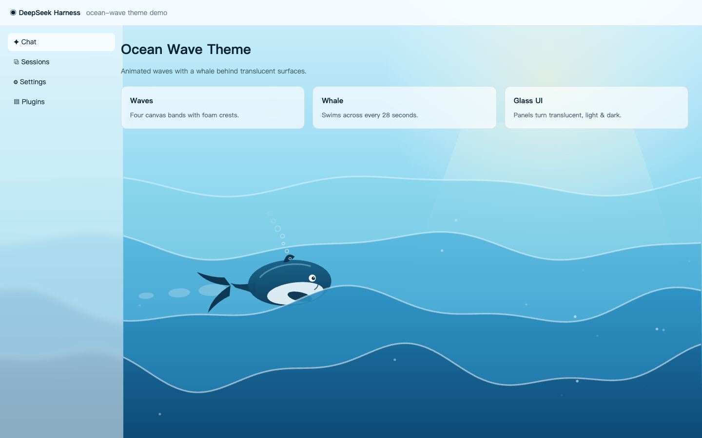
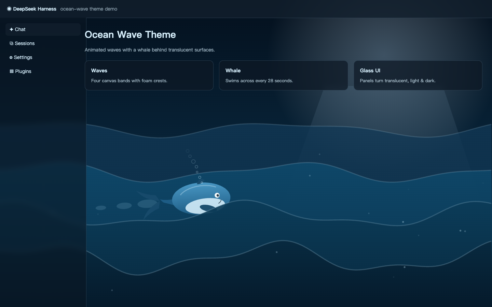

# Ocean Wave Theme / 大海海浪主题

Animated ocean waves with a whale swimming behind the page, plus translucent surfaces — a theme plugin for DeepSeek Harness (dsh) web.

整个应用背景铺设动态海浪特效，一条鲸鱼在页面后面游泳，界面各层变为半透明——适用于 DeepSeek Harness（dsh）web 端的主题插件。




## Features / 功能

- Four canvas wave bands with foam crests, sun/moon glow and twinkling sparkles. / 四层 canvas 波浪＋浪花边、太阳/月亮光晕与闪烁波光。
- A whale that swims left → right every 28 seconds, riding the mid wave crest with wake trail, paddling fins and rising bubbles. / 一条鲸鱼每 28 秒自左向右游过，骑在中间波峰上，带尾迹、摆动鳍与上升气泡。
- Translucent light/dark surfaces via design-token overrides, so the ocean shows through sidebars and panels. / 明暗两套半透明 token，侧栏与面板透出海浪。
- Follows the app color scheme (`data-ds-dark-theme`), pauses when the tab is hidden, and renders a still frame under `prefers-reduced-motion`. / 跟随应用明暗切换；标签页隐藏时暂停；`prefers-reduced-motion` 下只渲染静态帧。

## Install / 安装

From the dsh-market **Themes** tab (one click), or via CLI / 从 dsh-market 的**主题** Tab 一键安装，或命令行：

```bash
dsh plugin --profile web add github:johnsonspirit/ocean-wave-theme
```

The theme applies immediately and can be switched/uninstalled like any other theme. / 主题即时生效，可像其他主题一样切换与卸载。

## Layout / 结构

| File | Role |
|---|---|
| `index.js` | Host half (no-op; all rendering lives in the client). |
| `client.js` | Client half: canvas backdrop + token overrides. |
| `cordis.patch.yml` | Bundle patch inserting the plugin row. |
| `locale/en.json`, `locale/zh.json` | Bilingual title/description. |
| `assets/screenshot-*.png` | Storefront screenshots (declared in `screenshots.json`). |

## Compatibility / 兼容性

- dsh web only (`dsh.client.platform: web`). / 仅 dsh web 端。
- No dependencies, no network calls, no build step. / 零依赖、无网络请求、无需构建。

## License / 许可

MIT — see [LICENSE](LICENSE).
